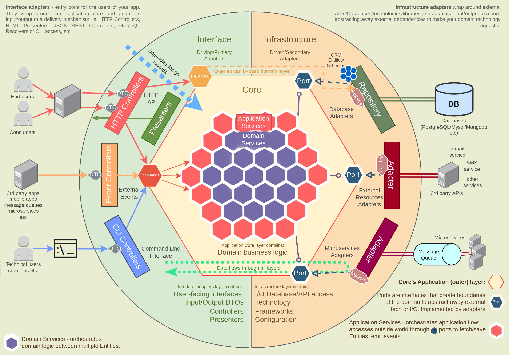

[](https://biomejs.dev/) [](http://commitizen.github.io/cz-cli/) [](https://github.com/marcoturi/fastify-boilerplate/blob/main/LICENSE)  

A production-ready [Fastify 5](https://github.com/fastify/fastify) boilerplate built on Clean Architecture, CQRS, DDD, and functional programming. Designed as a starting point for real-world applications, the architecture is framework-agnostic at its core — the patterns and boundaries translate to any language or framework.

## Table of Contents

- [Features](#features)
- [Prerequisites](#prerequisites)
- [Getting Started](#getting-started)
- [Available Scripts](#available-scripts)
- [Running with Docker](#running-with-docker)
- [API Endpoints](#api-endpoints)
- [Architecture](#architecture)
  - [Principles](#principles)
  - [Modules](#modules)
  - [Module Components](#module-components)
- [Folder Structure](#folder-structure)
- [OpenTelemetry](#opentelemetry)
- [Testing](#testing)
- [Client Types Package](#client-types-package)
- [CI/CD Pipeline](#cicd-pipeline)
- [AI-Assisted Development](#ai-assisted-development)
- [Why Biome over ESLint + Prettier?](#why-biome-over-eslint--prettier)
- [Useful Resources](#useful-resources)
- [Contributing](#contributing)
- [License](#license)

## Features

| Category | Details |
|---|---|
| **Runtime** | Native TypeScript via [Node.js >= 26](https://nodejs.org/en/blog/release/v26.0.0) type stripping — no build step, no transpiler |
| **Framework** | [Fastify 5](https://github.com/fastify/fastify) with [Awilix](https://github.com/jeffijoe/awilix) DI and [Pino](https://github.com/pinojs/pino) logging |
| **API** | REST ([TypeBox](https://github.com/sinclairzx81/typebox) schemas, Swagger UI) + GraphQL ([Mercurius](https://github.com/mercurius-js/mercurius), GraphiQL in dev) |
| **Database** | [Postgres.js](https://github.com/porsager/postgres) client + [DBMate](https://github.com/amacneil/dbmate) migrations & seeds |
| **Security** | [@fastify/helmet](https://github.com/fastify/fastify-helmet), [@fastify/under-pressure](https://github.com/fastify/under-pressure) for back-pressure |
| **Telemetry** | Vendor-agnostic [OpenTelemetry](https://opentelemetry.io/) with auto-instrumentation (disabled by default) |
| **Linting** | [Biome](https://biomejs.dev/) — single tool for linting, formatting, and import sorting |
| **Architecture** | [dependency-cruiser](https://github.com/sverweij/dependency-cruiser) validates layer boundaries in the pre-commit hook and in CI |
| **Release** | [Husky](https://github.com/typicode/husky) + [Commitlint](https://commitlint.js.org/) + [Semantic Release](https://github.com/semantic-release/semantic-release) |
| **Client types** | REST (OpenAPI) and GraphQL types [auto-generated and published to npm](#client-types-package) on every release |
| **Testing** | E2E with [Cucumber](https://cucumber.io/docs/installation/javascript/) (Gherkin), unit/integration with `node:test`, load tests with [k6](https://github.com/grafana/k6) |
| **Docker** | Production-ready multi-stage [Dockerfile](Dockerfile) (Alpine, non-root, health check) + [Docker Compose](docker-compose.yml) |
| **AI-Ready** | [AGENTS.md](AGENTS.md) — architecture rules and coding conventions for AI assistants |

## Prerequisites

| Tool | Notes |
|---|---|
| **Node.js** | >= 26 — required for native TypeScript execution and synchronous module hooks (OpenTelemetry). A `.nvmrc` is included — run `fnm use` or `nvm use` |
| **pnpm** | >= 12 — package manager. Node >= 25 no longer bundles Corepack: `npm install -g corepack && corepack enable` to activate the pinned version |
| **Docker** | Used to run PostgreSQL via Docker Compose. Alternatively, use a local Postgres install |

## Getting Started

```bash
# 1. Scaffold from the template
npx degit marcoturi/fastify-boilerplate my-app
cd my-app

# 2. Install dependencies
pnpm install

# 3. Create your .env file
pnpm create:env          # copies .env.example → .env

# 4. Start PostgreSQL (pick one)
docker compose up postgres -d   # via Docker Compose
# — or use a local Postgres and adjust .env values —

# 5. Run database migrations
pnpm db:migrate

# 6. Start the dev server (with watch mode and pretty logs)
pnpm start
```

The server starts at **http://localhost:3000** by default. See [API Endpoints](#api-endpoints) for what's available.

## Available Scripts

### Development

| Script | Description |
|---|---|
| `pnpm start` | Start dev server with watch mode and pretty-printed logs |
| `pnpm start:prod` | Start production server (no watch, no pretty-print) |
| `pnpm create:env` | Copy `.env.example` to `.env` (fails if `.env` already exists) |

### Code Quality

| Script | Description |
|---|---|
| `pnpm check` | Run lint + format check + type check (use this before committing) |
| `pnpm check:fix` | Same as `check` but auto-fixes lint and format issues |
| `pnpm format` | Auto-format all files with Biome |
| `pnpm lint` | Run Biome linter with auto-fix |
| `pnpm type:check` | TypeScript type checking (`tsc --noEmit`) |
| `pnpm deps:validate` | Validate architecture layer boundaries with dependency-cruiser |
| `pnpm deps:graph` | Generate a dependency graph SVG in `doc/` (requires [Graphviz](https://graphviz.org/) `dot`) |

### Testing

| Script | Description |
|---|---|
| `pnpm test` | Run unit tests (alias for `test:unit`) |
| `pnpm test:unit` | Run unit and integration tests with `node:test` |
| `pnpm test:coverage` | Run unit tests with c8 coverage |
| `pnpm test:e2e` | Run E2E tests with Cucumber (requires running Postgres) |

### Database

| Script | Description |
|---|---|
| `pnpm db:migrate` | Apply pending migrations |
| `pnpm db:create-migration` | Create a new migration file |
| `pnpm db:seed` | Run database seeds |
| `pnpm db:create-seed` | Create a new seed file |
| `pnpm db:seed:users` | Create users through the REST API with [k6](https://github.com/grafana/k6) (requires k6 and a server on port 3000) |
| `pnpm db` | Show the DBMate help (commands without a script, e.g. `rollback`, run with `pnpm exec dbmate`) |

### Other

| Script | Description |
|---|---|
| `pnpm generate:types` | Generate REST and GraphQL client types (requires running server + DB) |

## Running with Docker

### Full stack (app + Postgres)

```bash
pnpm create:env       # create .env from .env.example (if not done already)
docker compose up     # builds the app image and starts all services
```

### Standalone image

```bash
docker build -t fastify-boilerplate .
docker run -p 3000:3000 --env-file .env \
  -e NODE_ENV=production \
  -e POSTGRES_URL=host.docker.internal:5432 \
  --add-host=host.docker.internal:host-gateway \
  fastify-boilerplate
```

The `-e` flags override two values of a `.env` made for local development: `NODE_ENV=development` would replace the image's `production`, and `127.0.0.1` inside the container is the container itself, so Postgres is reached through the host. The image already binds to `0.0.0.0`.

### Dockerfile highlights

- **Multi-stage build** — dependencies installed in an isolated stage for optimal layer caching
- **Node Alpine** — small footprint, native TypeScript execution (no build step)
- **Non-root user** — runs as an unprivileged `fastify` user (UID 1001)
- **dumb-init** — proper PID 1 signal forwarding for graceful shutdown
- **HEALTHCHECK** — built-in Docker health check against `/health` every 30 seconds

## API Endpoints

| Endpoint | Description |
|---|---|
| `GET /health` | Liveness check: the process is up ([@fastify/under-pressure](https://github.com/fastify/under-pressure)) |
| `GET /ready` | Readiness check: the database answers (503 otherwise) |
| `/api/...` | All REST routes are prefixed with `/api` (e.g. `/api/v1/users`) |
| `GET /api-docs` | Swagger UI (interactive API documentation) |
| `GET /api-docs/json` | OpenAPI 3.1.0 JSON spec |
| `POST /graphql` | GraphQL endpoint ([Mercurius](https://github.com/mercurius-js/mercurius)) |
| `GET /graphiql` | GraphiQL IDE (development only) |

## Architecture


<sup>Diagram adapted from [Domain-Driven Hexagon](https://github.com/Sairyss/domain-driven-hexagon)</sup>

### Principles

**Project-level:**

- **Adaptable complexity** — the structure scales up or down by adding or removing layers to match the application's actual needs.
- **Future-proofing** — framework code and business logic are separated. Dependencies are well-established and minimal.
- **Functional programming first** — composition and factory functions over classes and inheritance.
- **Microservices-ready** — vertical slices, path aliases, and CQRS make it straightforward to extract a module into its own service later.

**Code-level:**

- **Framework-agnostic core** — business logic has no Fastify dependency. Fastify concerns stay in routes.
- **Protocol-agnostic handlers** — command/query handlers serve REST, GraphQL, gRPC, or CLI equally.
- **Database-agnostic domain** — SQL stays in repository files. Handlers interact with data through repository ports (interfaces).
- **Inward dependency flow** — outer layers depend on inner layers, never the reverse: `Route/Resolver → Handler → (Service) → Domain + Repository`. The domain is pure and never calls repositories.

Based on:

- [Domain-Driven Design (DDD)](https://en.wikipedia.org/wiki/Domain-driven_design)
- [Hexagonal (Ports and Adapters) Architecture](<https://en.wikipedia.org/wiki/Hexagonal_architecture_(software)>)
- [Clean Architecture](https://blog.cleancoder.com/uncle-bob/2012/08/13/the-clean-architecture.html)
- [Onion Architecture](https://herbertograca.com/2017/09/21/onion-architecture/)
- [SOLID Principles](https://en.wikipedia.org/wiki/SOLID)
- [Vertical Slice Architecture](https://www.jimmybogard.com/vertical-slice-architecture/)
- [Common Closure Principle (CCP)](https://en.wikipedia.org/wiki/Common_closure_principle)

### Modules

Each module maps to a domain concept and lives in its own folder under `src/modules/`. Modules follow the [vertical slice architecture](https://www.jimmybogard.com/vertical-slice-architecture/) — everything a feature needs is co-located.

**Key rules:**

- **No direct imports** between modules. Cross-module communication uses the CQRS buses (commands/queries for request-response, events for fire-and-forget). The one exception is another module's domain events (`domain/*.events.ts`), the contract its subscribers depend on; `pnpm deps:validate` enforces both.
- **Extractable** — any module can be pulled into a separate microservice. The CQRS handler boundary becomes the network boundary.
- **If two modules are too "chatty"**, they probably belong together — merge them.

> **CQRS:** see [doc/CQRS.md](doc/CQRS.md) for how the command, query, and event buses work — actions, handlers, middlewares, ordered per-key events, and worked examples.

### Module Components

Each layer has a single responsibility (details in [clean-architecture.md](.agents/rules/clean-architecture.md)):

**Route / Resolver** — handles the transport (REST route, GraphQL resolver; gRPC or CLI would be one more adapter). Validates input, dispatches one action on a bus, shapes the response. No business logic.

> All REST routes are prefixed with `/api` (configured in `src/server/index.ts`).

Example: [find-users.route.ts](src/modules/user/queries/find-users/find-users.route.ts), [find-users.resolver.ts](src/modules/user/queries/find-users/find-users.resolver.ts)

**Command/Query Handler** — runs one use case. Receives a command or query, calls a few domain, service or repository functions, returns a result or emits events. One handler per use case (e.g. `CreateUser`, `FindUsers`).

Benefits of the CQRS bus pattern:
- **Middlewares** — cross-cutting concerns (metadata, tracing, timing; auth, caching, rate limiting) plug in between route and handler. A middleware wraps every action of its bus: one meant for some actions only checks `action.type` (e.g. the `user/` prefix). See [middlewares.ts](src/shared/cqrs/middlewares.ts).
- **Decoupling** — modules communicate through the bus instead of direct imports, making future extraction to microservices trivial.

Example: [find-users.handler.ts](src/modules/user/queries/find-users/find-users.handler.ts)

**Service** — orchestrates a use case that takes several steps: reads from repositories, asks the domain for decisions, writes, emits events. It decides nothing itself. Add one when a handler grows into orchestration or two handlers share it; the boilerplate has none yet.

**Domain** — pure business logic: decisions, computations, invariants, entity creation. It may record domain events (`withEvents`), but never calls repositories, emits events or does any I/O.

Example: [user.domain.ts](src/modules/user/domain/user.domain.ts)

**Repository** — data access. Converts between domain models and database rows. All SQL lives here. Implements a port (interface) defined alongside it.

Example: [user.repository.ts](src/modules/user/database/user.repository.ts)

> **Guideline:** use as many or as few layers as needed. Not every feature needs a service or domain logic — simple CRUD operations can go straight from handler to repository.

## Folder Structure

```
.
├── db/
│   ├── migrations/                → SQL migration files (DBMate)
│   └── seeds/                     → SQL seed files (DBMate)
├── tests/
│   ├── <module>/
│   │   ├── <slice>/
│   │   │   ├── <scenario>.feature → Gherkin E2E scenarios (REST and GraphQL)
│   │   │   └── <slice>.k6.ts      → k6 load test scripts
│   │   └── <module>*.steps.ts     → Step definitions shared by the module's scenarios
│   ├── shared/                    → Cross-module scenarios and common steps
│   └── support/                   → Test server, hooks, custom world
├── client/                        → Generated REST + GraphQL client types (npm package)
├── scripts/                       → Type generation scripts
└── src/
    ├── index.ts                   → Entry point: logger, server start, graceful shutdown
    ├── instrumentation.ts         → OpenTelemetry setup (loaded via --import)
    ├── config/                    → Environment validation (env-schema + TypeBox)
    ├── modules/
    │   ├── index.ts                                 → Global DI dependencies (db, logger, buses, repository base)
    │   └── <module>/
    │       ├── commands/
    │       │   └── <command>/
    │       │       ├── <command>.handler.ts         → Command handler + its action creator
    │       │       ├── <command>.event-handler.ts   → Event subscriber (in place of a handler)
    │       │       ├── <command>.route.ts           → REST route
    │       │       ├── <command>.resolver.ts        → GraphQL resolver
    │       │       ├── <command>.graphql-schema.ts  → GraphQL type definitions
    │       │       └── <command>.schema.ts          → TypeBox request schemas
    │       ├── queries/
    │       │   └── <query>/                         → Same files as a command
    │       ├── database/
    │       │   ├── <module>.repository.port.ts      → Repository interface (port)
    │       │   └── <module>.repository.ts           → Repository implementation (adapter)
    │       ├── domain/
    │       │   ├── <module>.domain.ts               → Pure business logic
    │       │   ├── <module>.events.ts               → Domain events (the only cross-module import)
    │       │   ├── <module>.errors.ts               → Domain-specific errors
    │       │   └── <module>.types.ts                → Domain types
    │       ├── dtos/
    │       │   ├── <module>.graphql-schema.ts       → Shared GraphQL types
    │       │   └── <module>.response.dto.ts         → Shared response DTOs
    │       ├── <name>.service.ts                    → Optional orchestration layer (none yet)
    │       ├── <module>.action-creator.ts           → Action creator with the module prefix
    │       ├── <module>.mapper.ts                   → Entity ↔ DB model ↔ DTO mapper
    │       └── index.ts                             → DI declarations, action creator re-export
    ├── server/
    │   ├── index.ts               → Fastify setup: Helmet, CORS, GraphQL, plugin and route autoload
    │   ├── di/                    → Awilix container: global dependencies and module autoload
    │   ├── plugins/               → Autoloaded plugins (CQRS, error handler, readiness, request context, Swagger)
    │   ├── graphql-schema.ts      → Merges the modules' GraphQL schemas
    │   ├── graphql-error-formatter.ts → Maps exceptions to GraphQL errors
    │   └── request-id.ts          → Request id from the `request-id` header, or a new UUID
    └── shared/
        ├── api/                   → Shared TypeBox DTOs (ids, pagination, errors)
        ├── app/                   → Request context accessors
        ├── cqrs/                  → Command/Query/Event bus, middlewares
        ├── db/                    → Postgres connection, transactions, repository base, SQL helpers
        ├── ddd/                   → Domain events recording (withEvents), mapper interface, query base
        ├── exceptions/            → Transport-neutral exceptions
        └── utils/                 → Ajv validator, timeouts, middleware composition
```

## OpenTelemetry

The project ships with a vendor-agnostic [OpenTelemetry](https://opentelemetry.io/) setup in [`src/instrumentation.ts`](src/instrumentation.ts). It uses the standard [OTLP](https://opentelemetry.io/docs/specs/otlp/) protocol, so it works with any backend (Grafana, Datadog, Honeycomb, Jaeger, etc.) without code changes.

**How it works:**

- **HTTP + Fastify** — the SDK registers the [ESM loader hook](https://github.com/open-telemetry/opentelemetry-js/blob/main/doc/esm-support.md) and initialises with `instrumentation-http` and [`@fastify/otel`](https://github.com/fastify/otel). Every request gets a trace span with route, method, status code, and lifecycle hooks.
- **CQRS** — a tracing middleware in [`src/shared/cqrs/otel-middleware.ts`](src/shared/cqrs/otel-middleware.ts) wraps every command, query, and event in a span. Spans include the action type, bus kind, and correlation ID.
- **Disabled by default** (`OTEL_SDK_DISABLED=true`). When disabled, `@opentelemetry/api` returns noop implementations — zero overhead.

To enable, set the standard OTel environment variables in your `.env`:

```bash
OTEL_SDK_DISABLED=false
OTEL_SERVICE_NAME=fastify-boilerplate
OTEL_EXPORTER_OTLP_ENDPOINT=http://localhost:4318   # your OTLP collector
```

All configuration uses [standard OTel environment variables](https://opentelemetry.io/docs/languages/sdk-configuration/general/) — no vendor lock-in.

## Testing

### Unit and integration tests

Run with `node:test`. Test files live next to their source files as `*.spec.ts`.

```bash
pnpm test:unit           # run tests
pnpm test:coverage       # run with c8 coverage
```

### E2E tests

Written in [Gherkin](https://cucumber.io/docs/gherkin/) and executed with [Cucumber.js](https://cucumber.io/docs/installation/javascript/). Scenarios live next to the slice they cover, in `tests/<module>/<slice>/<scenario>.feature` (e.g. `tests/user/create-user/`). Step definitions shared by a module's scenarios are in `tests/<module>/*.steps.ts`; cross-module scenarios and common steps are in `tests/shared/`.

```bash
# Requires a running Postgres with migrations applied
pnpm test:e2e
```

The E2E test server is created via `buildApp()` (in `tests/support/server.ts`) — it boots a full Fastify instance without binding to a port, so tests run fast and don't conflict with a running dev server.

### Load tests

[k6](https://github.com/grafana/k6) scripts live alongside their feature's E2E tests.

Example: [create-user.k6.ts](tests/user/create-user/create-user.k6.ts)

## Client Types Package

The release pipeline automatically generates **REST** (OpenAPI) and **GraphQL** client types and publishes them as the [`@marcoturi/fastify-boilerplate`](https://www.npmjs.com/package/@marcoturi/fastify-boilerplate) npm package. The version is kept in sync with the backend via semantic-release.

### Install

```bash
pnpm add -D @marcoturi/fastify-boilerplate
```

### Usage

```typescript
// REST types (generated by openapi-typescript)
import type { paths, components } from '@marcoturi/fastify-boilerplate/rest';

// GraphQL types (generated by graphql-codegen)
import type { User, Query, Mutation } from '@marcoturi/fastify-boilerplate/graphql';
```

### Generate locally

To regenerate the types against a local server (requires running Postgres with migrations applied):

```bash
pnpm generate:types
```

This starts the server, fetches the OpenAPI and GraphQL schemas, writes the type files to `client/`, and stops the server.

## CI/CD Pipeline

The project uses GitHub Actions with three workflows, and [Renovate](https://docs.renovatebot.com/) for dependency updates.

**[ci.yml](.github/workflows/ci.yml)** — runs on every pull request to `main`. Its `Check and test` job is a required status check of the `main` branch ruleset, so a pull request merges only when it passes:

1. Install dependencies (`pnpm install --frozen-lockfile`)
2. Code quality checks (`pnpm check`)
3. Unit tests (`pnpm test`)
4. Architecture boundaries (`pnpm deps:validate`)
5. Database migrations (`pnpm db:migrate`) against a Postgres service container
6. E2E tests (`pnpm test:e2e`)

**[release.yml](.github/workflows/release.yml)** — runs on every push to `main`:

1. Install dependencies (`pnpm install --frozen-lockfile`)
2. Code quality checks (`pnpm check`)
3. Unit tests (`pnpm test`)
4. Architecture boundaries (`pnpm deps:validate`)
5. Database migrations (`pnpm db:migrate`) against a Postgres service container
6. E2E tests (`pnpm test:e2e`)
7. Generate client types (`pnpm generate:types`)
8. Publish release via semantic-release (changelog, GitHub release, npm client package)

semantic-release pushes the release commit with the `GH_TOKEN` secret, a personal access token allowed to bypass the ruleset: the checkout step uses `persist-credentials: false` so that token, not the default workflow credentials, does the push.

**[codeql-analysis.yml](.github/workflows/codeql-analysis.yml)** — runs on pushes and PRs to `main`:

- GitHub CodeQL security analysis for JavaScript/TypeScript

**[Renovate](renovate.json)** — opens a pull request for each dependency update once the release is 3 days old. Minor and patch updates are merged automatically when CI passes; major updates wait for a review. pnpm also refuses releases younger than `minimumReleaseAge` in [pnpm-workspace.yaml](pnpm-workspace.yaml) when installing, lockfile included.

## AI-Assisted Development

This project ships with an [`AGENTS.md`](AGENTS.md) file — a guide for AI coding assistants. It documents the architecture, coding conventions, and common pitfalls so that tools like [Cursor](https://cursor.com/), [Claude Code](https://docs.anthropic.com/en/docs/claude-code), and [GitHub Copilot](https://github.com/features/copilot) can generate code that follows the project's established patterns.

AI assistants automatically pick up `AGENTS.md` and apply the conventions without manual prompting.

Area-specific rules (clean architecture, CQRS, database, API, modules, testing, infrastructure) live in [`.agents/rules/`](.agents/rules), each with a `paths` frontmatter listing the files it covers, so they enter the context only when relevant. `AGENTS.md` points every assistant to them; Claude Code loads them automatically through the `.claude/rules` symlink.

> On Windows, clone with symlinks enabled (Developer Mode on, then `git clone -c core.symlinks=true …`), otherwise `.claude/rules` is checked out as a plain text file and Claude Code will not load the rules.

## Why Biome over ESLint + Prettier?

This project uses [Biome](https://biomejs.dev/) as a single tool for linting, formatting, and import sorting:

- **One tool, zero plugins** — no `@typescript-eslint/parser`, `eslint-config-prettier`, `eslint-plugin-import`, or other ecosystem packages to keep in sync.
- **Fast** — written in Rust, orders of magnitude faster than ESLint + Prettier. Noticeable in CI and pre-commit hooks.
- **Stable** — no more breakage from mismatched plugin versions or peer dependency conflicts across the ESLint ecosystem.
- **Mature** — covers the vast majority of rules that ESLint + typescript-eslint provide, with a growing community and clear roadmap.

## Useful Resources

- [Domain-Driven Hexagon](https://github.com/Sairyss/domain-driven-hexagon) — the primary inspiration for this project's architecture (adapted toward functional programming)
- [react-redux boilerplate](https://github.com/marcoturi/react-redux-boilerplate) — companion frontend boilerplate by the same author

## Contributing

Contributions are welcome! This project uses [Conventional Commits](https://www.conventionalcommits.org/) enforced by Commitlint and Husky.

1. Fork and clone the repo
2. Create a branch: `git checkout -b your-feature`
3. Make your changes
4. Run `pnpm check` to validate lint, format, and types
5. Run `pnpm test` (and `pnpm test:e2e` if your change touches API behavior)
6. Commit using [Conventional Commits](https://www.conventionalcommits.org/) format (e.g. `feat: add user roles`)
7. Open a Pull Request

## License

[MIT](https://choosealicense.com/licenses/mit/)
